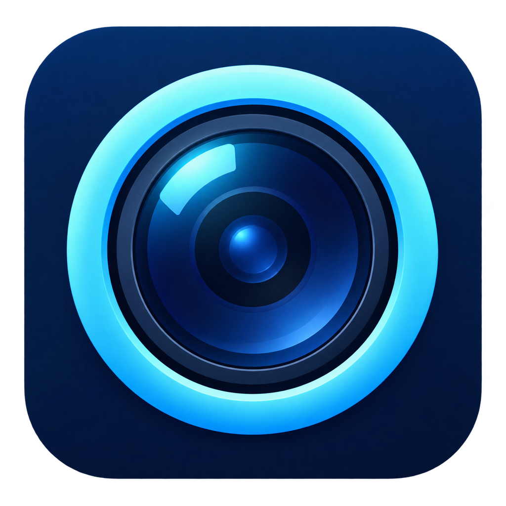
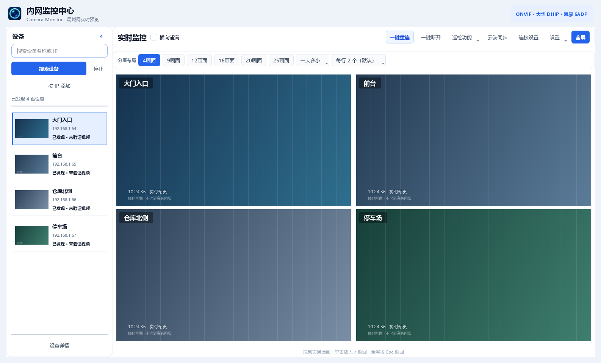
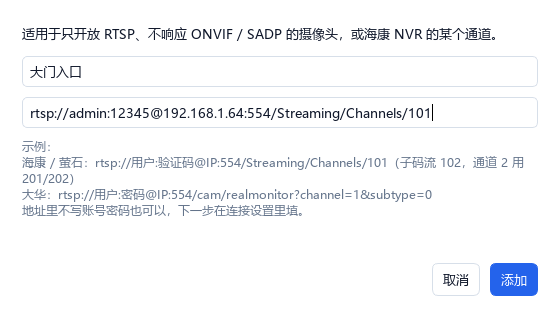
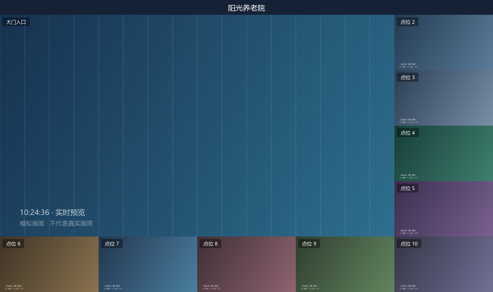
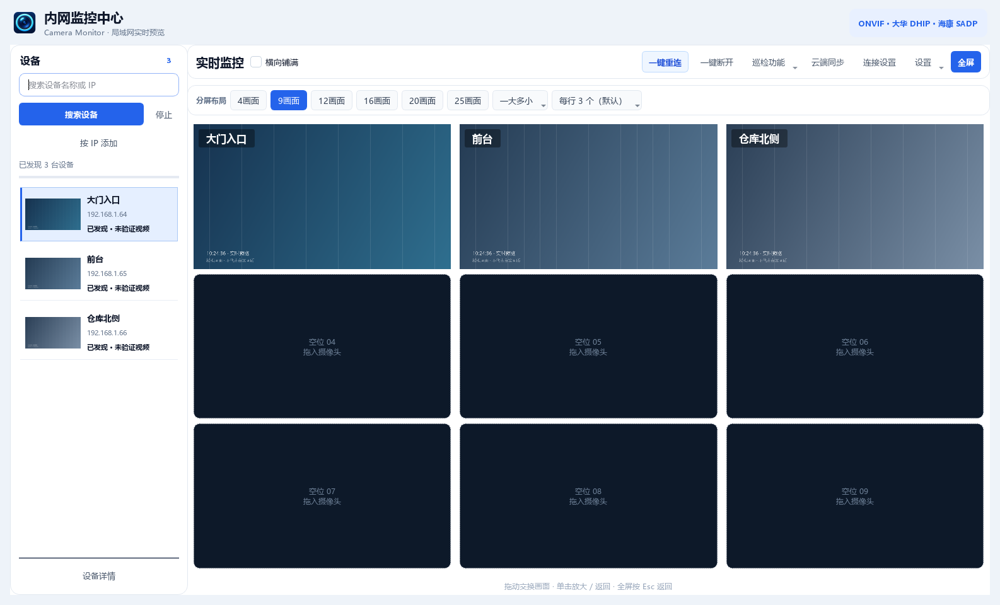
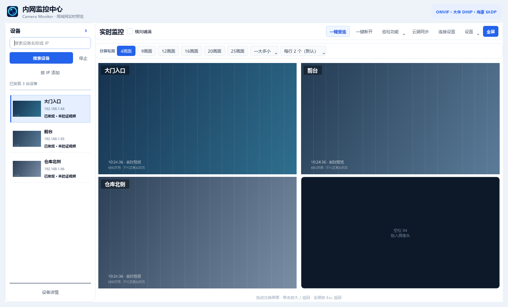
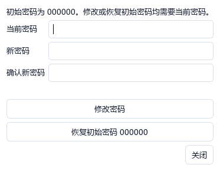
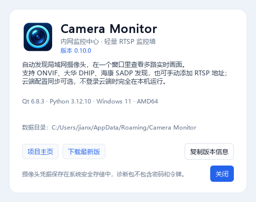

<p align="center">
  
</p>

# Camera Monitor · 内网监控播放器

轻量的跨品牌 **RTSP 摄像头监控软件**，自动发现局域网设备，在一个窗口中查看多个位置的实时画面。支持 Windows 11 64 位和 Apple M 系列 Mac。

## 下载

| 系统 | 下载最新版 | 使用方式 |
| --- | --- | --- |
| Windows 11 · Intel / AMD 64 位 | [下载 Windows 版](https://github.com/jianxiashao/CameraMonitor/releases/latest/download/CameraMonitor-Windows11-x64.zip) | 解压后运行 `CameraMonitor.exe` |
| macOS 14+ · Apple M 系列 | [下载 Mac 版](https://github.com/jianxiashao/CameraMonitor/releases/latest/download/CameraMonitor-macOS-AppleSilicon.zip) | 解压后将 `Camera Monitor.app` 拖入“应用程序” |

无需安装 Python。[全部版本与更新记录](https://github.com/jianxiashao/CameraMonitor/releases) · [Windows 使用说明](packaging/Windows使用说明.md) · [Mac 使用说明](packaging/macOS使用说明.md)

## 主要功能

- **自动发现与预览**：搜索 ONVIF / 大华 DHIP / 海康 SADP 兼容设备，左侧紧凑列表显示缩略图、名称和 IP，点击缩略图查看大图。海康 SADP 会一并读出型号、序列号和 ONVIF 地址，便于确认是哪一台。
- **手动 RTSP**：只开放 RTSP、不响应 ONVIF / SADP 的摄像头（如萤石）或海康 NVR 通道，点左侧「手动 RTSP」，填地址即可添加；地址里的账号密码会拆出来存进系统安全存储。
- **横向铺满**：顶部勾选“横向铺满（允许变形）”即可消除左右留白，画面与空位一起拉宽、不裁切；关闭后恢复 16:9。设置自动保存，普通窗口与全屏均生效。
- **每行数量**：等分布局可在顶部分别设置每行几个画面，自动保存；12 格默认 3 列 × 4 行，20 格默认 4 列 × 5 行。每格保持 16:9，窗口比例不匹配时保留外侧留白。
- **固定分屏**：4、9、12、16、20、25 格等分，6、10、15 格一大多小；设备不足时保留空位。10 格环绕布局横竖各 5 格，共用右下角，周边小画面尺寸一致。
- **自由调整位置**：摄像头之间、摄像头与空位之间可拖拽换位并保存位置；单击画面放大，再次单击还原。
- **大屏展示**：视频区域保持 16:9，可设置机构名称、摄像头名称的颜色和四角位置。全屏隐藏侧栏与操作按钮。
- **巡检功能**（工具栏「巡检功能」菜单）：
  - **一键检测**：逐路重新取一次画面，并汇总正常 / 异常（黑屏、断流）/ 未播放各多少路，明细列出具体 IP。
  - **巡检截图**：把每路当前画面存成 JPG，统一放进保存根的当天日期文件夹
    （`2026-10-22/大门口_203445.jpg`）。文件名用摄像头名称，没名称时用 IP（点换下划线），
    同一秒重名自动加 `-2`、`-3` 不覆盖。保存位置在「设置 → 巡检截图保存位置…」里选，
    第一次点按钮会先提示去设置。
- **画面自检**：每格右上角有**延迟指示灯**（绿=实时、黄=略滞后、红=正在追帧）；画面持续全黑时出现红色告警条，恢复后自动消失；每路还能按 1 帧/秒存最近 10 分钟，用「回看」看刚才发生了什么。
- **云台控制**：画面「云台」按钮或操作菜单打开 ONVIF PTZ 面板，按住方向键持续转动、松开停止，支持缩放和预置位调用。
- **告警与值守**：黑屏 / 冻结 / 恢复会写进 SQLite 告警记录（「设置 → 告警记录…」可查看、导出 CSV），并可弹系统通知、发送 Webhook（企业微信、钉钉或自建服务）。
- **巡检报告**：巡检截图会叠加摄像头名称、IP 和时间，并在当天文件夹里生成一份 `巡检报告.html`。
- **回看**：默认从最新一段开始，可切换从头播放、1x/2x/4x/8x 倍速；最近 10 分钟的缩时画面不用再等十分钟。
- **布局方案**：「设置 → 布局方案」可把当前的格数、顺序、每行数量、横向铺满和机构名称存成命名方案，一键切换。
- **画面比例**：每路可单独选完整画面 / 铺满裁剪 / 拉伸铺满；设备列表右键可直接连接、改设置、重命名、复制 IP 或从墙上移除。
- **连接设置**：选中设备后点工具栏右侧的「连接设置」（或画面上的齿轮），设置面板从右侧浮出，关闭时不占画面宽度。
- **全屏密码锁**：退出全屏需验证密码，初始密码为 `000000`；支持修改，以及验证当前密码后恢复初始密码。
- **连接管理**：支持批量设置账号密码、系统安全存储、TCP / UDP 传输；断线按 3、6、12、24 秒退避重连，最长间隔 30 秒。
- **云端同步（可选）**：填入管理员发放的授权码后，摄像头列表、画面顺序、分屏布局和账号密码保存在云端，换电脑或重装系统只需再填一次码。不填则保持纯单机，不访问外网。断网时照常使用，改动会在联网后自动补传。一个授权码只能绑一台电脑。
- **运维工具**（「设置」菜单）：导出诊断包、配置导入 / 导出、深色 / 浅色主题、每天定时自动重启、巡检截图保存位置、崩溃后自动重启（守护模式）、检查更新、云端服务器地址、**关于 Camera Monitor**。守护模式适合长期无人值守：父进程发现异常退出后 5 秒自动拉起；傻瓜模式默认开启。关于窗口显示版本、Qt / Python / 系统环境和数据目录，可复制版本信息或打开项目主页。
- **开机自动启动、启动后自动全屏**：「设置」菜单里有两个带勾选状态的选项。勾了开机自动启动，电脑开机登录后自动打开软件（Mac 要先把程序拖进「应用程序」文件夹）；勾了启动后自动全屏，软件一打开、墙上铺好摄像头就进全屏，退出照旧要输大屏密码。登录云端时这两项也会同步，管理员可以在后台设备码编辑页修改。

分屏数量、画面顺序以及墙上有哪几路摄像头会跨重启保留，不登录云端也一样，重启后自动恢复播放。当前支持 **RTSP 视频预览**，暂不支持 RTMP、音频和完整的连续录像；「回看」是最近 10 分钟、每秒一帧的缩时画面，不是取证级录像。自动发现需要摄像头开启兼容协议（ONVIF、大华 DHIP 或海康 SADP）；如果已知 IP 但搜索不到，可点击左侧 **按 IP 添加**，输入摄像头 IPv4 地址进行定向探测，识别成功后填写连接账号密码。定向添加不会清空当前设备列表，未收到回复时会提示检查网络和 ONVIF 设置。

只支持 RTSP 的设备（例如萤石、海康 NVR 的某个通道）用左侧 **手动 RTSP** 添加，填完整地址即可，不需要先被自动发现。

## 傻瓜模式（云端托管）

管理员在后台把设备码设为「傻瓜模式」后，现场电脑只需输入一次设备码：

- 界面只剩监控画面，点击、拖动、快捷键都不起作用；
- 是否全屏、分屏、顺序、摄像头账号密码全部由后台远程设置，约 1 秒生效；
- 自动设为开机运行，断电重启后自动恢复画面；
- 维护人员按 `Ctrl+Shift+Alt+Q`（Mac 上是 `Control+Shift+Option+Q`，不是 ⌘：⌘⇧⌥Q 是系统的「立即注销」）并输入维护密码，可以退出软件或解除绑定。

外网断开时画面照常播放，只是暂时收不到后台的新设置。

傻瓜模式下顶部工具栏不显示，「开机自动启动」「启动后自动全屏」这两个选项也不起作用：开机启动一直开着，全屏在后台远程页设置。切回完整模式后，开机启动按完整模式里的勾选来，没勾过就会关掉。

## 界面预览

以下截图来自当前界面。视频区域使用模拟画面展示布局，不代表真实摄像头的画质或并发性能。

### 顶部品牌栏、设备卡片与监控工作台

顶部是程序图标、标题和协议徽标；左侧设备栏用卡片显示缩略图、名称、IP 与状态；
右侧工具栏和分屏栏分成两张浮动卡片，常用操作集中在右侧。



### 手动添加只支持 RTSP 的摄像头

萤石、部分品牌摄像头或海康 NVR 的某个通道不一定响应 ONVIF / SADP。点左侧「手动 RTSP」，
填显示名称和完整地址即可添加；地址里的账号密码会自动拆到系统安全存储。



### 10 格环绕大屏

一个主画面与九个等尺寸小画面；顶部展示机构名称，摄像头名称叠加在画面上，全屏时自动隐藏工具栏。



### 固定分屏与空位

选择 9 格就是 3×3；只有 3 台摄像头时，其余 6 格保留虚线空位，拖入即可上墙。



### 拖到空位，调整监控顺序

把“大门入口”拖到右下角空位后，原来的左上角变为空位，播放对象保持不变。



### 大屏密码设置

修改密码和恢复初始密码都需要验证当前密码。



### 关于 Camera Monitor

「设置 → 关于 Camera Monitor…」或托盘菜单可以查看版本、Qt / Python / 系统环境、数据目录，
并复制版本信息或打开项目主页。关于窗口不显示摄像头密码和云端令牌。



## 快速使用

1. 电脑与摄像头连接同一局域网，点击 **搜索设备**。
2. 双击设备，按需输入账号密码；连接设置中可保存位置名称。已有凭据时自动尝试获取缩略图，正在播放的设备优先复用现有画面。
   - 只支持 RTSP、不响应 ONVIF / SADP 的设备（如萤石、海康 NVR 通道），点左侧 **手动 RTSP**，填名称和完整地址添加。
3. 左下方 **批量账号密码** 可统一配置所选设备；已经播放的设备在下次手动连接时使用新凭据。
4. 顶部选择分屏数量。拖动画面到另一画面或空位即可换位，单击画面放大／还原。
5. 工具栏最右侧那一组按钮依次是 **一键重连 / 一键断开 / 巡检功能 / 云端同步 / 连接设置 / 设置 / 全屏**：
   - 选中左侧设备后点 **连接设置**，面板从右侧浮出，改完点「收起设置」；
   - **巡检功能** 里是「一键检测」和「巡检截图」；
   - **设置** 里可改机构名称、大屏密码、启动选项（开机自启 / 启动全屏 / 守护模式）、布局方案，以及诊断包、配置导入导出、主题、自动重启、巡检截图保存位置、告警记录、告警 Webhook、云端服务器地址、检查更新、关于。
6. 需要在多台电脑之间同步配置时，点 **云端同步**，输入管理员给的授权码。授权码只需输入一次。
7. 通过 **设置 → 大屏密码…** 修改初始密码。按 **F11** 进入全屏；按 Esc、F11 或尝试关闭窗口时，输入正确密码才能退出全屏。全屏中仍可放大／还原、拖拽排序。

## 常见问题

- **搜不到设备？** 请确认处于同一局域网，摄像头已开启 ONVIF / 兼容发现协议，并允许软件访问局域网。Windows 防火墙请选择信任的专用网络。如果是萤石这类只开 RTSP 的摄像头，用左侧「手动 RTSP」直接填地址添加；部分萤石型号还要先在 App 里开启「RTSP」或关闭视频加密。
- **海康 NVR 怎么加？** SADP 能搜到 NVR 时可直接添加；也可以「手动 RTSP」填 `rtsp://用户:密码@NVR地址:554/Streaming/Channels/101`，通道 2 用 `201`，子码流用 `102`。
- **缩略图显示“需登录”？** 先在连接设置中输入正确凭据并播放；没有账号密码时不会自动尝试登录。放大的缩略图是最近获取的一帧，并非实时视频。
- **画面外围有留空？** 所有视频区域按 16:9 排布，源画面完整拉伸至该比例、不裁切；屏幕比例不匹配时，留空集中在监控墙外围。
- **频繁断流？** 可停止播放后尝试“UDP（兼容模式）”。网络、设备兼容性和码率也会影响稳定性。
- **授权码提示「已被占用」？** 一个授权码只能绑一台电脑。换电脑或重装系统后，请管理员在后台该档案上点「解绑电脑」再重新输入。
- **密码存在哪里？** 摄像头凭据保存在当前系统用户的安全存储中，不会随安装包转移到另一台电脑；启用云端同步后会另外加密保存在云端，换电脑时自动取回。大屏锁属于应用内控制，不能阻止操作系统强制结束程序。
- **Mac 首次打开被拦截？** 本版尚未经过 Apple 公证。确认下载来源后，按 [Apple 官方说明](https://support.apple.com/zh-cn/102445)在“系统设置 → 隐私与安全性”中允许打开。
- **`start-windows.bat` 双击后报错或一闪而过？** 从 PowerShell 里执行 `.\start-windows.bat` 看完整输出；常见原因是没装 64 位 Python 3.12/3.13、`.venv` 被别的程序占用，或首次安装依赖时网络/代理不通。逐条排查见[启动脚本失败排查](本地测试说明.md#6-start-windowsbat-启动失败排查)。

## 从源码运行

**Windows 一键启动**：双击根目录的 `start-windows.bat`。它会自动找 64 位 Python 3.12 / 3.13，复用已有的 `.venv` 或 `.venv-win`，缺依赖时才联网安装，然后启动程序。

手动启动：

```sh
py -3.12 -m venv .venv          # 必须是 64 位 3.12 / 3.13，3.14 没有 PySide6 6.8 的轮子
# 激活虚拟环境后执行：
python -m pip install -r requirements.txt
python -m camera_monitor.app
```

如果 `start-windows.bat` 失败，先看窗口里最后几行；常见原因和手动命令见
[本地测试说明 · 启动脚本失败排查](本地测试说明.md#6-start-windowsbat-启动失败排查)。

支持在 Windows / Apple 芯片 Mac 本地打包，也可使用仓库中的 GitHub Actions 云端构建。详见 [Windows 打包说明](packaging/Windows使用说明.md)与 [macOS 打包说明](packaging/macOS使用说明.md)。

本地怎么跑测试、查代码、验证打包产物，见 [本地测试说明](本地测试说明.md)。

要把源码上传到自己的 GitHub 仓库并让 Actions 产出可下载的 exe，见 [上传到 GitHub 说明](上传GitHub使用说明.md)。
